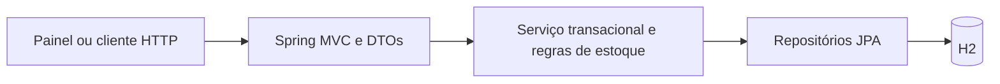
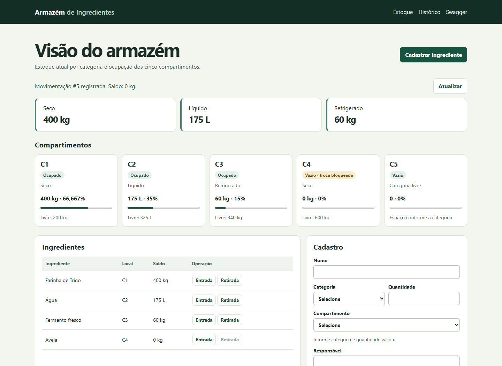
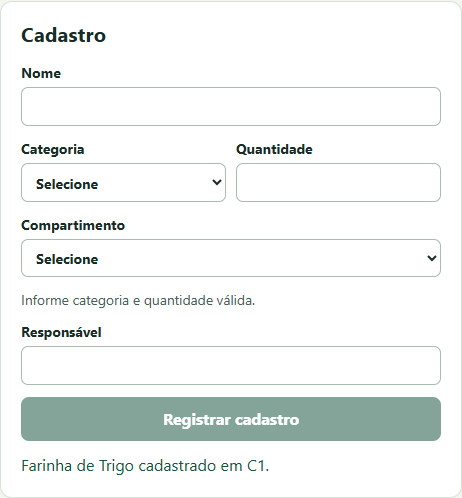
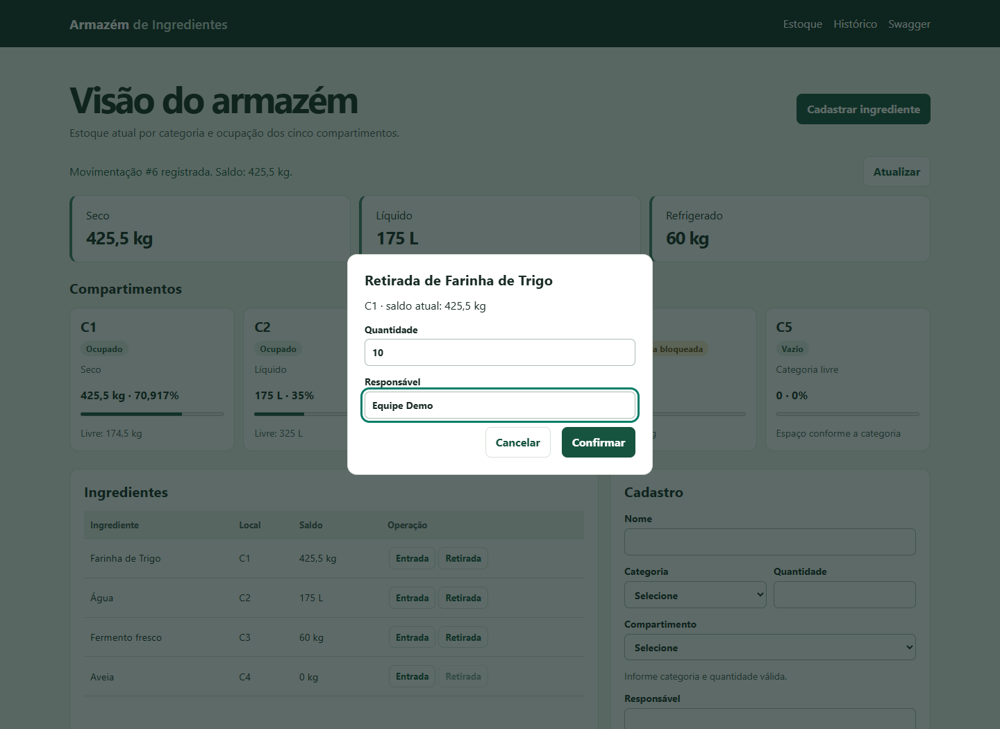
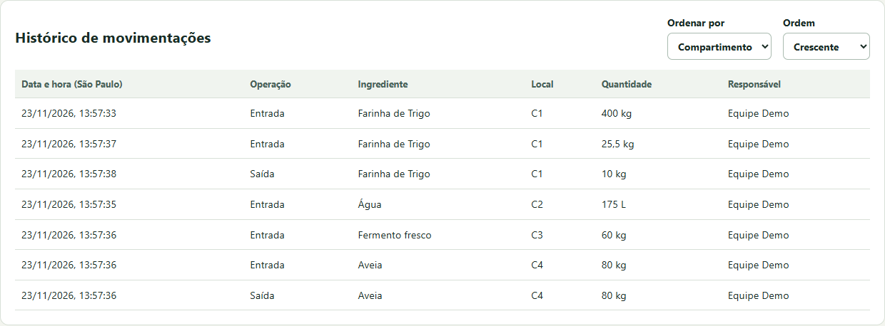
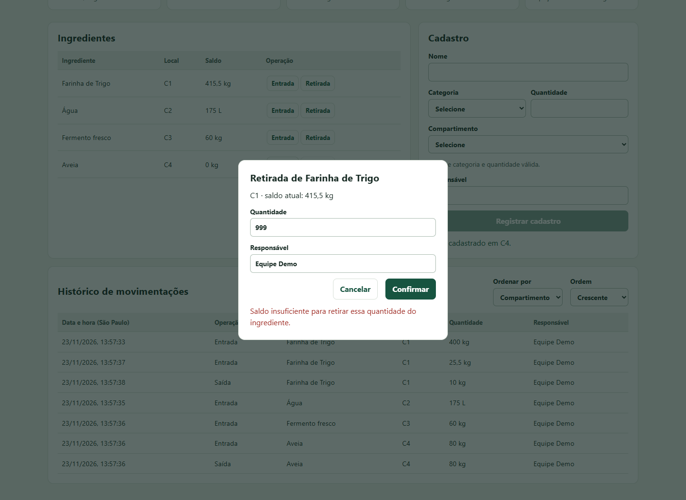
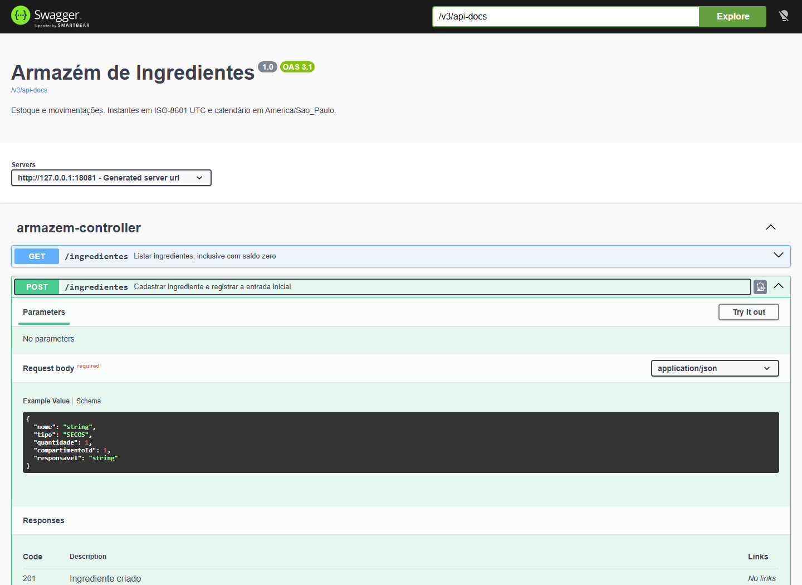

# Armazém de Ingredientes

API REST e painel web para controlar o estoque de ingredientes de uma fábrica de alimentos. O armazém tem cinco compartimentos fixos, de C1 a C5. Cada um guarda uma categoria por vez e pode conter vários ingredientes dessa categoria.

| Categoria | Capacidade por compartimento |
| --- | ---: |
| Seco (`SECO`) | 600 kg |
| Líquido (`LIQUIDO`) | 500 L |
| Refrigerado (`REFRIGERADO`) | 400 kg |

## Executar localmente

Instale o JDK 21. O Maven Wrapper baixa o Maven 3.9.9 na primeira execução e o Maven obtém as dependências. A aplicação usa Spring Boot 3.5, Spring MVC, JPA, Bean Validation, H2 e springdoc. O painel usa HTML, CSS e JavaScript servidos pelo próprio Spring Boot.

```powershell
# Windows
.\mvnw.cmd clean verify
.\mvnw.cmd spring-boot:run
```

```bash
# Linux, macOS ou WSL
./mvnw clean verify
./mvnw spring-boot:run
```

Também é possível executar o pacote após o build com `java -jar target/armazem-1.0.0.jar`. Execute na raiz para usar sempre a mesma pasta de dados.

- Painel em [localhost:8080](http://localhost:8080/)
- Swagger UI em [localhost:8080/swagger-ui/index.html](http://localhost:8080/swagger-ui/index.html)
- Documento OpenAPI em [localhost:8080/v3/api-docs](http://localhost:8080/v3/api-docs)



O perfil padrão usa `./data/armazem.mv.db` e começa sem ingredientes. Para reiniciar, encerre a aplicação com Ctrl+C e execute o mesmo comando na mesma pasta. O esquema é reaplicado de forma idempotente e o Hibernate valida as tabelas. Para zerar um ambiente de desenvolvimento, pare a aplicação e mova `data/armazem.mv.db` para um backup antes de iniciar novamente.

## Contrato HTTP

| Método e rota | Resultado |
| --- | --- |
| `POST /ingredientes` | 201 e `Location`. Cadastra estoque inicial e registra uma entrada |
| `GET /ingredientes` | Lista ingredientes, inclusive os zerados |
| `GET /ingredientes/{id}` | Retorna um ingrediente |
| `GET /ingredientes/volume` | Retorna saldo agregado das três categorias, inclusive total zero |
| `POST /ingredientes/{id}/entradas` | Repõe saldo. Retorna `ingredienteId`, `quantidade` e `movimentacaoId` |
| `POST /ingredientes/{id}/retiradas` | Retira do saldo do ingrediente. Retorna os mesmos campos da reposição |
| `GET /compartimentos` | Retorna C1 a C5 com ocupação e último uso |
| `GET /compartimentos/disponiveis?quantidade=100&tipo=SECO` | Filtra espaços capazes de receber toda a entrada |
| `GET /compartimentos/disponiveis-para-venda?tipo=SECO` | Filtra compartimentos com estoque positivo da categoria |
| `GET /historico?sortBy=date&order=desc` | Lista movimentações. Aceita `date\|compartimento` e `asc\|desc` |

Com `sortBy=date`, os desempates usam compartimento e ID. Com `sortBy=compartimento`, usam data e ID. Todos seguem a mesma direção do parâmetro `order`. Instantes são retornados em ISO-8601 UTC. O painel os exibe no fuso de São Paulo.

Em um banco novo, registre 400 kg de farinha e consulte o saldo.

```bash
curl -i http://localhost:8080/ingredientes \
  -H 'Content-Type: application/json' \
  -d '{"nome":"Farinha de Trigo","tipo":"SECOS","quantidade":400,"compartimentoId":1,"responsavel":"Equipe Demo"}'
curl http://localhost:8080/ingredientes/volume
```

O cadastro retorna 201 e, em um banco novo, `Location: /ingredientes/1`. Os volumes são `[{"type":"SECO","totalQuantity":400.000},{"type":"LIQUIDO","totalQuantity":0},{"type":"REFRIGERADO","totalQuantity":0}]`. O alias `SECOS` é aceito no corpo JSON. Respostas e parâmetros de consulta usam os nomes canônicos.

No PowerShell, após esse cadastro, reponha 25,500 kg usando o ID retornado.

```powershell
$body = @{ quantidade = 25.500; responsavel = 'Equipe Demo' } | ConvertTo-Json
Invoke-RestMethod -Method Post -Uri 'http://localhost:8080/ingredientes/1/entradas' -ContentType 'application/json' -Body $body
```

O saldo passa a 425,500 kg e a resposta identifica a nova movimentação. Para retirar, troque `entradas` por `retiradas`. A API aceita quantidades positivas com até três casas decimais, sem arredondamento. Validação e regras de estoque retornam 400, IDs positivos inexistentes retornam 404 e duplicidade ou conflito técnico retornam 409. O erro contém `timestamp`, `status`, `error`, `message`, `path` e `fields`.

## Calendário e integridade do estoque

Se C1 for esvaziado às 23h59 em São Paulo, ele pode receber a mesma categoria imediatamente. Uma categoria diferente pode entrar a partir da meia-noite, desde que C1 continue vazio. A retirada que zera o compartimento registra o dia de uso. Ingredientes zerados permanecem consultáveis. Uma reposição volta a validar as regras vigentes e cadastro duplicado recebe orientação para repor.

A operação bloqueia a linha do compartimento antes de carregar saldos. Uma segunda escrita no mesmo compartimento aguarda e valida o estado resultante da primeira. Cadastro, atualização de saldo, registro de último uso e histórico participam da mesma transação. Operações sobre compartimentos diferentes usam linhas de bloqueio diferentes.

Quando um compartimento vazio pode receber qualquer categoria, `GET /compartimentos` devolve capacidade, espaço livre e unidade nulos. A consulta com categoria informa os valores na unidade aplicável. Um compartimento vazio com restrição diária informa a capacidade reservada à última categoria.

## Testes e limitações

`clean verify` executa testes unitários das regras de ocupação e testes HTTP com MockMvc e H2 em memória. A suíte cobre limites, validação, troca de categoria à meia-noite, estoque zerado, ordenação, falha de persistência e concorrência com duas threads e transações reais. Consulte o [registro de validação](docs/VALIDACAO.md) e as [decisões técnicas](docs/DECISOES_TECNICAS.md).

H2 em arquivo atende à demonstração local. Para produção, seria necessário validar o bloqueio sob carga no SGBD escolhido e adotar migrações versionadas. Listas são retornadas integralmente, adequadas ao volume do desafio. A identificação do responsável é declarada no payload.

## Demonstração visual

As capturas foram feitas no Microsoft Edge com o JAR em execução e dados fictícios.



O painel mostra C4 vazio com troca de categoria bloqueada e C5 disponível para qualquer categoria.

<details>
<summary>Cadastro, movimentações, histórico, validação e Swagger</summary>



Confirmação do cadastro após consultar os compartimentos compatíveis.



Retirada de 10 kg preparada após uma reposição de 25,5 kg.



Histórico com data e hora de São Paulo, responsável, operação e quantidade.



A API rejeita a retirada acima do saldo do ingrediente.



Contrato de cadastro no Swagger, com o exemplo de categoria `SECOS`.

</details>

O [guia de capturas](docs/screenshots/README.md) descreve como reproduzir os fluxos.

## Uso de IA no desenvolvimento

O Codex auxiliou na implementação, nos testes, na interface e nesta documentação. As verificações executadas estão registradas em [Validação](docs/VALIDACAO.md). A revisão humana da entrega cabe ao autor antes do compartilhamento.
